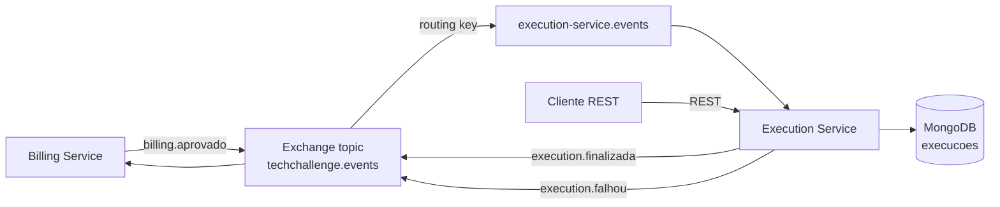
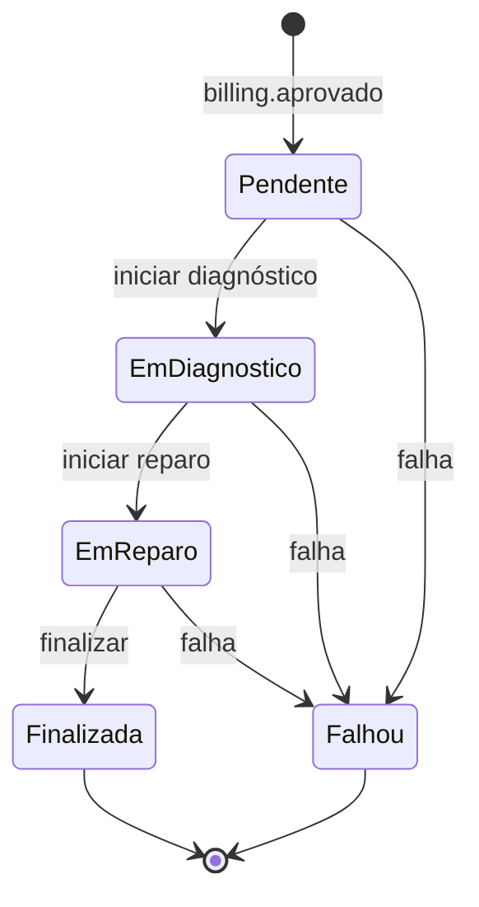
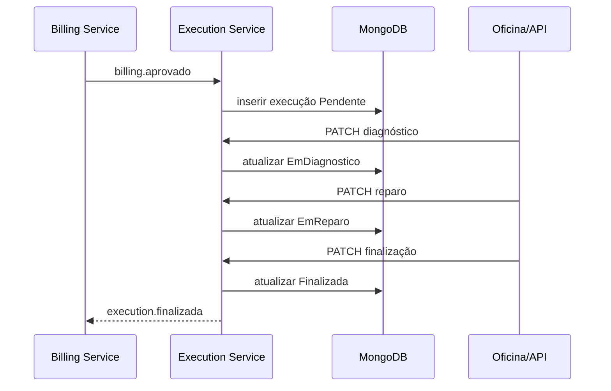

# Execution Service

Serviço responsável por registrar e acompanhar a execução das ordens de serviço de uma oficina mecânica.

Este repositório faz parte do Tech Challenge FIAP - Pós-Tech Arquitetura de Software, Fase 4, e integra a Saga coreografada do ecossistema com **OS Service** e **Billing Service**.

## 1. Visão geral e responsabilidades

O Execution Service:

- recebe a aprovação do orçamento e cria uma execução no estado `Pendente`;
- expõe operações REST para iniciar diagnóstico, iniciar reparo, finalizar ou falhar uma execução;
- persiste as execuções no MongoDB;
- consome `billing.aprovado` pelo RabbitMQ;
- publica `execution.finalizada` após uma finalização bem-sucedida;
- publica `execution.falhou` quando uma falha é registrada ou uma falha de negócio impede a criação da execução;
- fornece endpoint de health check e documentação Swagger.

Este serviço não processa cobranças, pagamentos ou estornos. A compensação financeira pertence ao Billing Service.

## 2. Arquitetura e estrutura do projeto

O código está dividido em quatro projetos .NET:

```text
src/
├── TechChallenge.Execution.Domain/
│   └── Execucao.cs                 # Estados e regras de transição
├── TechChallenge.Execution.Application/
│   ├── ExecucaoService.cs          # Casos de uso e persistência
│   └── Messaging.cs                # Contratos de eventos e handler de orçamento aprovado
├── TechChallenge.Execution.Infrastructure/
│   ├── MongoExecucaoRepository.cs  # Acesso ao MongoDB
│   └── Messaging/RabbitMq.cs       # Publicador e consumidor RabbitMQ
└── TechChallenge.Execution.Api/
    └── Program.cs                  # Configuração, DI, health check e endpoints REST

tests/TechChallenge.Execution.Tests/
├── ExecucaoTests.cs
├── ExecucaoServiceTests.cs
├── OrcamentoAprovadoHandlerTests.cs
└── FalhaExecucaoTests.cs
```



### Responsabilidades por camada

- **Domain:** entidade `Execucao`, enum `StatusExecucao` e regras de transição.
- **Application:** coordenação dos casos de uso, contratos de mensagens e idempotência da aprovação.
- **Infrastructure:** implementação MongoDB, RabbitMQ, DLX e fila de erros.
- **API:** minimal APIs, Swagger, health check e tratamento HTTP de exceções de domínio.

## 3. Tecnologias utilizadas

- .NET 10 / C#
- ASP.NET Core Minimal APIs
- MongoDB.Driver 3.14.0
- RabbitMQ.Client 7.2.0
- MongoDB 7
- RabbitMQ 3 Management no Docker Compose
- Docker e Docker Compose
- Swashbuckle/Swagger
- xUnit, Microsoft.NET.Test.Sdk e Coverlet
- GitHub Actions
- SonarScanner for .NET, opcionalmente configurado pela esteira

## 4. Pré-requisitos e configurações

### Pré-requisitos

- .NET SDK 10
- Docker Desktop ou Docker Engine com Compose
- MongoDB local, RabbitMQ local ou contêineres equivalentes
- PowerShell 7 recomendado para os exemplos

### Configuração da aplicação

As configurações são lidas a partir da configuração ASP.NET Core e podem ser fornecidas por variáveis de ambiente.

| Variável | Padrão | Uso |
|---|---|---|
| `MONGODB_CONNECTION_STRING` | `mongodb://localhost:27017` | Conexão MongoDB |
| `MONGODB_DATABASE` | `execution` | Banco utilizado |
| `RABBITMQ_ENABLED` | `false` | Habilita publicador e consumidor RabbitMQ |
| `RABBITMQ_HOST` | `localhost` | Host RabbitMQ |
| `RABBITMQ_PORT` | `5672` | Porta AMQP |
| `RABBITMQ_USER` | `guest` | Usuário |
| `RABBITMQ_PASSWORD` | `guest` | Senha |
| `RABBITMQ_VHOST` | `/` | Virtual host |

Quando `RABBITMQ_ENABLED=false`, a aplicação usa `NoOpEventPublisher`; tentativas de publicação falham de forma explícita com `InvalidOperationException`.

O repositório não define um usuário ou senha real de produção. Os valores `guest/guest` são padrões locais do código e da imagem RabbitMQ. Credenciais de ambientes reais devem ser fornecidas por configuração segura.

## 5. Como executar localmente

### Restaurar e executar

```powershell
Set-Location C:\Projetos\tech-challenge-execution-service
dotnet restore .\TechChallenge.Execution.slnx
dotnet run --project .\src\TechChallenge.Execution.Api\TechChallenge.Execution.Api.csproj
```

Por padrão, o launch profile HTTP usa `http://localhost:5016`, mas a porta pode variar conforme o perfil e o ambiente.

### MongoDB e RabbitMQ locais

Com Docker:

```powershell
docker run --detach --name execution-mongo -p 27017:27017 mongo:7
docker run --detach --name execution-rabbitmq -p 5672:5672 -p 15672:15672 rabbitmq:3-management
```

Execute a API com mensageria habilitada:

```powershell
$env:MONGODB_CONNECTION_STRING = "mongodb://localhost:27017"
$env:MONGODB_DATABASE = "execution"
$env:RABBITMQ_ENABLED = "true"
$env:RABBITMQ_HOST = "localhost"
$env:RABBITMQ_PORT = "5672"
$env:RABBITMQ_USER = "guest"
$env:RABBITMQ_PASSWORD = "guest"
$env:RABBITMQ_VHOST = "/"

dotnet run --project .\src\TechChallenge.Execution.Api\TechChallenge.Execution.Api.csproj
```

Consulte o health check:

```powershell
Invoke-RestMethod -Method Get -Uri "http://localhost:5016/health"
```

Remova os contêineres de exemplo ao finalizar:

```powershell
docker rm --force execution-mongo execution-rabbitmq
```

## 6. Como executar com Docker Compose

O Compose inicia MongoDB, RabbitMQ e API:

```powershell
Set-Location C:\Projetos\tech-challenge-execution-service
docker compose up --build
```

A API fica exposta em `http://localhost:8080`.

Serviços e portas:

| Serviço | Porta local |
|---|---|
| API | `8080` |
| MongoDB | `27017` |
| RabbitMQ AMQP | `5672` |
| RabbitMQ Management | `15672` |

Os dados do MongoDB são mantidos pelo volume `mongo-data`.

```powershell
docker compose ps
Invoke-RestMethod -Method Get -Uri "http://localhost:8080/health"
docker compose logs --follow api
docker compose down
```

O `docker compose down` remove os contêineres e redes, mas mantém o volume nomeado. Para remover também o volume:

```powershell
docker compose down --volumes
```

## 7. Swagger e endpoints REST

Com a aplicação iniciada, o Swagger UI é servido por `UseSwaggerUI()` na raiz. Em geral:

- Swagger UI local: `http://localhost:5016/swagger`
- Swagger UI por Compose: `http://localhost:8080/swagger`
- Health: `/health`

A API expõe os seguintes endpoints:

| Método | Caminho | Descrição |
|---|---|---|
| `POST` | `/api/v1/execucoes` | Registra uma execução |
| `GET` | `/api/v1/execucoes/os/{uniqueCode}` | Consulta por código da OS |
| `PATCH` | `/api/v1/execucoes/os/{uniqueCode}/diagnostico` | Inicia diagnóstico |
| `PATCH` | `/api/v1/execucoes/os/{uniqueCode}/reparo` | Inicia reparo |
| `PATCH` | `/api/v1/execucoes/os/{uniqueCode}/finalizacao` | Finaliza a execução |
| `PATCH` | `/api/v1/execucoes/os/{uniqueCode}/falha` | Registra falha e inicia a compensação da Saga |

### Registrar uma execução

```powershell
$os = [guid]::NewGuid()
$body = @{ ordemServicoUniqueCode = $os } | ConvertTo-Json

Invoke-RestMethod -Method Post `
  -Uri "http://localhost:8080/api/v1/execucoes" `
  -ContentType "application/json" `
  -Body $body
```

### Consultar

```powershell
Invoke-RestMethod -Method Get -Uri "http://localhost:8080/api/v1/execucoes/os/$os"
```

### Avançar a execução

```powershell
Invoke-RestMethod -Method Patch -Uri "http://localhost:8080/api/v1/execucoes/os/$os/diagnostico"
Invoke-RestMethod -Method Patch -Uri "http://localhost:8080/api/v1/execucoes/os/$os/reparo"
Invoke-RestMethod -Method Patch -Uri "http://localhost:8080/api/v1/execucoes/os/$os/finalizacao"
```

Os endpoints PATCH não recebem corpo.

Os resultados incluem `id`, `ordemServicoUniqueCode`, `status`, `criadaEm`, `diagnosticoIniciadoEm`, `reparoIniciadoEm` e `finalizadaEm`. Uma OS inexistente retorna `404 Not Found`. A criação duplicada ou transição de estado inválida retorna `409 Conflict` com `{ "erro": "..." }`.

## 8. Estados e transições da execução



Regras atuais:

- `Pendente -> EmDiagnostico`;
- `EmDiagnostico -> EmReparo`;
- `EmReparo -> Finalizada`;
- `Pendente`, `EmDiagnostico` ou `EmReparo -> Falhou`;
- chamar diagnóstico em um estado diferente de `Pendente` é inválido;
- chamar reparo em um estado diferente de `EmDiagnostico` é inválido;
- chamar finalização em um estado diferente de `EmReparo` é inválido;
- uma execução `Finalizada` não pode ser alterada ou marcada como `Falhou`;
- uma execução já `Falhou` não altera seu estado ao falhar novamente.

A falha pode ser chamada pela API ou, no fluxo observado pelo handler, pode ser publicada como consequência de uma falha de negócio ao processar `billing.aprovado`.

## 9. Persistência MongoDB

A coleção utilizada é `execucoes`.

O repositório:

- obtém uma execução pelo `ordemServicoUniqueCode`;
- verifica duplicidade;
- insere documentos;
- substitui documentos ao atualizar;
- cria o índice único `ux_ordem_servico_unique_code` em `OrdemServicoUniqueCode`.

Esse índice impede duas execuções para a mesma OS no nível do MongoDB. A API trata `MongoWriteException` com categoria `DuplicateKey` e transforma a situação em `DuplicidadeException`.

Campos adicionais persistidos para falhas:

- `FalhaEventoId`: GUID reutilizado em reenvios da mesma falha;
- `FalhaOcorridaEm`: instante da primeira falha;
- `FalhaPublicadaEm`: instante em que a publicação foi concluída.

Não há migrations; a coleção e o índice são preparados pela implementação do repositório.

## 10. Eventos RabbitMQ consumidos e publicados

### Configuração AMQP

- Exchange: `techchallenge.events`
- Tipo: `topic`
- Exchange de erro/DLX: `techchallenge.events.dlx`
- Fila principal: `execution-service.events`
- Fila de erro: `execution-service.events.error`
- QoS: 1 mensagem por consumidor

### Evento consumido

| Routing key | Contrato | Comportamento |
|---|---|---|
| `billing.aprovado` | `OrcamentoAprovado(EventId, OrdemServicoUniqueCode, OccurredAt)` | Cria a execução como `Pendente` |

Os JSON são deserializados em camelCase. Campos esperados:

```json
{
  "eventId": "9bf74525-11b0-41cc-8289-5bce73429944",
  "ordemServicoUniqueCode": "73f78736-c644-4f1b-a509-aae4ce40ce31",
  "occurredAt": "2026-11-17T21:05:15Z"
}
```

### Eventos publicados

| Routing key | Contrato | Origem |
|---|---|---|
| `execution.finalizada` | `ExecucaoFinalizada(EventId, OrdemServicoUniqueCode, OccurredAt)` | PATCH de finalização |
| `execution.falhou` | `ExecucaoFalhou(EventId, OrdemServicoUniqueCode, Motivo, OccurredAt)` | Falha da execução ou falha de negócio ao consumir aprovação |

O contrato `ExecucaoSolicitada` existe na classe `Messaging.cs`, mas não há publicação ou routing key implementada para ele no código atual.

Exemplo de `execution.falhou`:

```json
{
  "eventId": "df9db2d3-62d4-42ec-a071-5eb4938d84d7",
  "ordemServicoUniqueCode": "73f78736-c644-4f1b-a509-aae4ce40ce31",
  "occurredAt": "2026-11-17T21:05:15Z"
}
```

O campo opcional `motivo` é omitido quando nulo.

## 11. Participação na Saga coreografada

A participação implementada nesta unidade é:

1. **Billing Service** aprova o orçamento e publica `billing.aprovado`.
2. **Execution Service** consume o evento e cria uma execução `Pendente`.
3. A oficina avança a execução pelas APIs de diagnóstico, reparo e finalização.
4. Ao finalizar, o Execution Service publica `execution.finalizada`.
5. Se a execução falhar, o Execution Service persiste `Falhou` e publica `execution.falhou`.



A compensação financeira é responsabilidade exclusiva do **Billing Service**. Ao receber `execution.falhou`, o Billing Service decide e executa a compensação; o Execution Service não consulta nem altera registros financeiros.

## 12. Fluxo de execução bem-sucedido

```text
billing.aprovado
  -> Pendente
  -> EmDiagnostico
  -> EmReparo
  -> Finalizada
  -> execution.finalizada
```

Em detalhes:

1. `billing.aprovado` cria a execução.
2. `PATCH diagnóstico` exige `Pendente`.
3. `PATCH reparo` exige `EmDiagnostico`.
4. `PATCH finalização` exige `EmReparo`.
5. A finalização persiste `Finalizada`.
6. Um novo `ExecucaoFinalizada` é publicado.

Se a publicação de `execution.finalizada` falhar, o estado já foi persistido como `Finalizada`, a falha é registrada em log e a API continua retornando sucesso. Não existe Outbox nem mecanismo automático nesta implementação para tentar publicar novamente esse evento.

## 13. Fluxo de falha e compensação

```text
billing.aprovado
  -> Pendente
  -> Falhou
  -> execution.falhou
  -> Billing Service solicita/realiza compensação
```

O fluxo pode começar em `Pendente`, `EmDiagnostico` ou `EmReparo`. O estado `Falhou` é persistido antes da publicação e o Billing Service é responsável pela compensação financeira.

## 14. Endpoint `PATCH /api/v1/execucoes/os/{uniqueCode}/falha`

Exemplo:

```powershell
$os = [guid]::NewGuid()

# 1. Criar execução via API
$body = @{ ordemServicoUniqueCode = $os } | ConvertTo-Json
Invoke-RestMethod -Method Post `
  -Uri "http://localhost:8080/api/v1/execucoes" `
  -ContentType "application/json" `
  -Body $body

# 2. Registrar falha
Invoke-RestMethod -Method Patch `
  -Uri "http://localhost:8080/api/v1/execucoes/os/$os/falha"
```

Respostas esperadas:

- `200 OK`: execução com status `Falhou`;
- `404 Not Found`: não existe execução para a OS;
- `409 Conflict`: a execução está `Finalizada` ou outra transição é inválida;
- `500 Internal Server Error`: RabbitMQ está desabilitado ou a publicação falha.

O endpoint usa os campos de falha persistidos para identificar uma tentativa pendente de publicação. Quando a publicação é bem-sucedida, `FalhaPublicadaEm` é persistido.

## 15. Idempotência e tratamento de mensagens duplicadas

### Aprovação repetida

O handler de `OrcamentoAprovado` considera `DuplicidadeException` como sucesso: um evento repetido para uma OS que já possui execução é ignorado e reconhecido pela fila.

Além da verificação da aplicação, o índice único do MongoDB garante unicidade por `OrdemServicoUniqueCode`.

### Falha repetida

`Falhar()` é idempotente quando o estado já é `Falhou`. Uma chamada repetida não gera novo estado nem novo campo de ocorrência.

Quando uma falha foi persistida mas a publicação caiu:

- `FalhaPendentePublicacao` continua verdadeiro;
- uma nova chamada usa o mesmo `FalhaEventoId`;
- o evento é publicado novamente;
- consumidores podem deduplicar pelo `EventId`.

Não há, porém, uma coleção ou índice local de `EventId` consumido. Por isso, o consumidor não deduplica pelo `EventId`; a idempotência é obtida principalmente pela unicidade da execução por OS e pela regra de falha já persistida.

## 16. Persistência de eventos e tentativas de publicação

Não existe uma tabela, coleção ou Outbox formal de eventos para todos os eventos.

O que existe:

- os campos `FalhaEventoId`, `FalhaOcorridaEm` e `FalhaPublicadaEm` são persistidos no documento `Execucao`;
- `FalhaPublicadaEm` marca o sucesso da publicação de `execution.falhou`;
- o `FalhaEventoId` é preservado em reenvios, permitindo que consumidores dedupliquem a falha;
- a atualização que marca a falha publicada ocorre após o retorno do publicador.

Limitações:

- não existe Outbox automática ou worker de reenvio;
- não há persistência de `execution.finalizada` aguardando publicação;
- não há persistência de cada tentativa, horário de tentativa ou contagem de retry;
- não há transação distribuída entre MongoDB e RabbitMQ;
- uma falha em `execution.finalizada` não é reexecutada automaticamente;
- uma falha em `execution.falhou` pode ser reexecutada chamando novamente o PATCH, desde que o estado continue `Falhou`;
- publisher confirmations estão habilitados no canal, mas não há Outbox ou compensação para rejeição posterior.

O nome `ExecucaoSolicitada` é apenas um contrato definido no código; não há persistência ou publicação implementada para esse evento.

## 17. Tratamento de erros e limitações de resiliência

### API

Um middleware captura `DomainException` e `DuplicidadeException` e retorna `409 Conflict`.

Exceções não tratadas pelo middleware seguem o comportamento padrão da ASP.NET Core. O endpoint de falha também pode resultar em `500` se a publicação falhar.

### RabbitMQ

- o consumidor tenta reconectar a cada 5 segundos enquanto o broker está indisponível;
- mensagens inválidas ou com GUID vazio são rejeitadas sem reenvio;
- mensagens válidas que falham por exceção transitória são aguardadas por 5 segundos e reenviadas com `Nack(requeue=true)`;
- não há limite implementado de redelivery;
- mensagens inválidas vão para `execution-service.events.error` por meio do DLX;
- o exchange, a fila, o DLX e a fila de erro são declarados no início do consumidor;
- o evento repetido é processado com idempotência limitada à execução duplicada.

Outras limitações:

- não há circuit breaker;
- não há retry com backoff configurável no publicador;
- não há bulkhead nem rate limiting;
- a reconexão do publisher usa `AutomaticRecoveryEnabled`, mas não há fallback persistente;
- o consumidor não persiste `EventId` em uma coleção de eventos processados;
- o deserializador não valida uma mensagem completa além do objeto não nulo e GUID não vazio.

## 18. Testes automatizados e cobertura

O projeto `TechChallenge.Execution.Tests` usa xUnit e contém testes para domínio, serviço, handler de aprovação e falha.

Principais cenários cobertos:

- criação no estado `Pendente`;
- GUID vazio;
- fluxo completo por diagnóstico, reparo e finalização;
- transições inválidas;
- não alteração de execução finalizada;
- ausência de execução;
- duplicidade no registro;
- aprovação repetida;
- falha de negócio publicada;
- falha transitória propagada;
- finalização publicada;
- falha persistida e publicada uma vez;
- repetição da chamada de falha;
- falha de publicação e reenvio com o mesmo `EventId`;
- contrato JSON de `execution.falhou`.

Execução local:

```powershell
dotnet test .\tests\TechChallenge.Execution.Tests\TechChallenge.Execution.Tests.csproj -c Release
```

Resultado verificado nesta análise: **24 testes aprovados e 0 falhas**.

Não há um relatório de cobertura consolidado versionado no repositório. Portanto, o README não declara porcentagem de cobertura. A esteira gera Cobertura XML e OpenCover, mas o percentual efetivo só pode ser confirmado no artefato gerado pelo job.

Com cobertura de teste local:

```powershell
dotnet test .\tests\TechChallenge.Execution.Tests\TechChallenge.Execution.Tests.csproj `
  -c Release `
  --collect "XPlat Code Coverage" `
  --results-directory .\artifacts\test-results
```

## 19. CI/CD com GitHub Actions

A esteira `.github/workflows/ci.yml` é disparada por push e pull request para `feat/development`, além de `workflow_dispatch`.

Jobs:

1. **Restore e build:** restaura a solução, compila em Release e trata avisos como erros.
2. **Testes:** executa os 24 testes, gera TRX e cobertura e publica o artefato `test-results-unit`.
3. **SonarQube:** opcional, só executa quando as variáveis exigidas estão configuradas.
4. **Package:** publica a aplicação, inicia MongoDB e RabbitMQ efêmeros, publica `billing.aprovado` e verifica:
   - `/health` retorna `Healthy`;
   - a fila tem consumidor;
   - o evento é roteado;
   - a API consulta a execução criada no MongoDB como `Pendente`.

Em push direto para `feat/development`, o job gera:

- `execution-service-feat-development-<SHA>.tar.gz`;
- arquivo SHA256 correspondente;
- retenção de 30 dias.

Pull requests não geram o pacote de entrega.

## 20. SonarCloud, se configurado

O job de Sonar instalado no workflow suporta SonarQube Cloud ou Server, mas a execução depende de variáveis configuradas no GitHub Actions.

Variáveis esperadas:

- `SONAR_PROJECT_KEY`;
- `SONAR_ORGANIZATION`, para SonarCloud;
- `SONAR_REGION`, opcional para SonarCloud;
- `SONAR_HOST_URL`, para SonarQube Server;
- secret `SONAR_TOKEN`.

O job importa relatórios TRX e Cobertura OpenCover e aguarda o Quality Gate. Não há evidência neste repositório de um projeto SonarCloud já criado nem de um resultado ativo de Quality Gate. Portanto, Sonar/ SonarCloud deve ser considerado configurável pela pipeline, não comprovadamente concluído.

## 21. Kubernetes

Existe o manifesto [k8s/execution.yaml](k8s/execution.yaml), com:

- ConfigMap `execution-config`;
- Deployment `execution-api`;
- Service `execution-api`;
- Deployment e Service de MongoDB;
- readiness e liveness probes em `/health`.

Kubernetes não está completo para o ambiente da aplicação atual:

- não cria um RabbitMQ no cluster;
- não configura as variáveis `RABBITMQ_*`;
- não usa `MONGODB_CONNECTION_STRING` com credenciais seguras;
- não possui volume persistente para MongoDB;
- não define recurso de Secret;
- não define HorizontalPodAutoscaler;
- não configura imagePullSecrets;
- não contém manifesto de ingress;
- não demonstra deploy realizado em cluster.

Exemplo de aplicação local dos manifestos:

```powershell
kubectl apply -f .\k8s\execution.yaml
kubectl get deployments,pods,services
kubectl rollout status deployment/execution-api
Invoke-RestMethod -Method Get -Uri "http://localhost/health"
```

Os valores exatos de acesso dependem do ambiente de cluster e do encaminhamento de porta ou ingress, que não está definido no repositório.

## 22. Observabilidade e monitoramento

Recursos implementados:

- health check em `/health`;
- logs estruturados via `ILogger`;
- readiness e liveness no manifesto Kubernetes;
- logs da aplicação no RabbitMQ indisponível, publicações falhas e mensagens inválidas;
- artefatos de smoke test e cobertura no GitHub Actions.

Não há OpenTelemetry, Application Insights, Prometheus, Grafana, tracing distribuído ou métricas customizadas implementadas no repositório.

Sinais úteis para operação:

- `/health`;
- conectividade e consumidores na fila RabbitMQ;
- existência e tamanho do volume MongoDB;
- logs de transições inválidas e falhas de publicação;
- filas `execution-service.events` e `execution-service.events.error`;
- resultado do health check e dos smoke tests da esteira.

## 23. Decisões arquiteturais e limitações conhecidas

### Decisões observadas

- arquitetura em quatro projetos separados por domínio, aplicação, infraestrutura e API;
- Minimal APIs no ponto de entrada HTTP;
- MongoDB por ordem de serviço com índice único;
- Saga coreografada por exchange topic no RabbitMQ;
- publicação de falhas persistida pelo próprio documento da execução;
- uso de falha idempotente e GUID estável para reenvio;
- transições validadas no domínio.

### Limitações

- não há Outbox para execução finalizada;
- não há Outbox worker para reentregar `execution.falhou`;
- não há persistência completa de tentativas de publicação;
- não há garantia transacional distribuída entre MongoDB e RabbitMQ;
- o publicador não implementa retry próprio para falhas temporárias;
- o consumidor pode reenfileirar indefinidamente sem limite de redelivery;
- não há DLQ com política de retry por quantidade limitada;
- o `EventId` não é usado para deduplicar o handler de aprovação no nível do consumidor;
- a compensação financeira não pertence a este serviço;
- a API não possui autenticação ou autorização;
- a configuração local de RabbitMQ usa credenciais padrão;
- não há HTTPS configurado pela aplicação;
- não há versionamento formal de schemas de eventos além dos records C#;
- o manifesto Kubernetes não está pronto para produção;
- não há cobertura percentual declarada por falta de relatório local versionado.

## Pendências da Fase 4

Itens que ainda dependem de evidência ou implementação fora deste repositório:

- confirmar ou definir o resultado percentual de cobertura no SonarCloud/artefato do CI;
- configurar Sonar/ SonarCloud, caso o projeto continue opcional;
- implementar Outbox ou outra forma transacional para garantir entrega automática de `execution.finalizada` e `execution.falhou`;
- limitar retries e adicionar política de DLQ ou retentativa operacional;
- adicionar deduplicação persistente por `EventId`;
- completar o manifesto Kubernetes com RabbitMQ, Secret, volume persistente e variáveis de mensageria;
- confirmar um deploy Kubernetes real;
- adicionar autenticação/HTTPS e observabilidade distribuída;
- integrar todos os consumidores da Saga de forma completa nos repositórios dos serviços parceiros.
